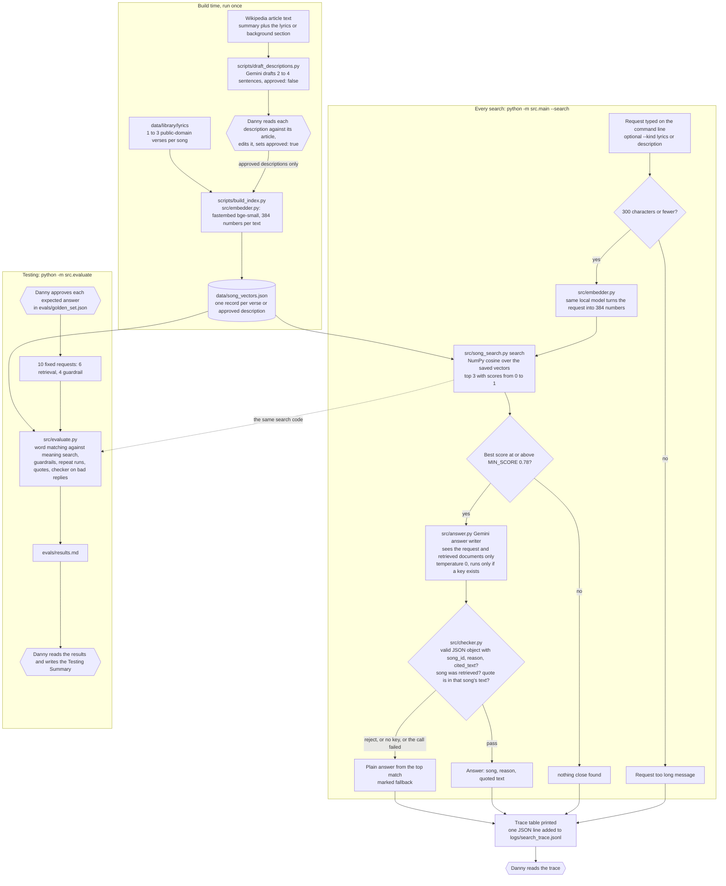

# Songs by Meaning: search a song library by what the songs are about

## Base project

This project extends the **Music Recommender Simulation** from CodePath AI110 Project 3: a command-line program that scores 20 invented songs against a listener's taste profile (genre, mood, energy, valence, acousticness) and prints a ranked playlist with the reasons for each pick. Project 4 leaves all of that working and adds a second mode, `--search`, which finds a song from a description of what it is about. The Project 3 README, as submitted, is kept in full in [`docs/PROJECT3_README.md`](docs/PROJECT3_README.md).

## What it adds

You type what a song is about. The system finds the closest lyric verses and song descriptions in a small vector index, and Gemini names the song and explains the match using only what was found. A checker then verifies Gemini's reply, and every search leaves a trace.

The library is separate from Project 3's invented songs:

- **Lyrics:** 1 to 3 verses each of five public-domain songs (Amazing Grace, Danny Boy, Go Down, Moses, Take Me Out to the Ball Game, and Yes! We Have No Bananas), one document per verse. Sources are listed in [`data/ATTRIBUTION.md`](data/ATTRIBUTION.md).
- **Descriptions:** 2 to 4 sentences each on what a song is about, with no lyrics quoted, for Changes (2Pac), Fast Car (Tracy Chapman), Jolene (Dolly Parton), What Was I Made For? (Billie Eilish) and the Batman playground parody of Jingle Bells. Gemini drafted each from its Wikipedia article, and each was read and approved by the student before it was indexed. The parody is a description only; none of its lines are stored.

It needs no key to search: the embedding model runs locally, and with no Gemini key the answer is the top match and its text, marked as a fallback.

## Setup and run

Tested from a fresh copy of the repo, a new `uv` environment and no `.env` on Nov 18, 2026. Run from the repo root. The project uses [uv](https://docs.astral.sh/uv/) with Python 3.13 (pinned in `.python-version`):

```bash
uv venv
uv pip install -r requirements.txt
.venv/bin/python --version        # Python 3.13.x
.venv/bin/python -m pytest -q     # 104 passed
```

Search by meaning:

```bash
.venv/bin/python -m src.main --search "buying snacks at the stadium"
.venv/bin/python -m src.main --search "a call to free an enslaved people" --kind lyrics
```

- `--search "TEXT"` searches the library. Requests over 300 characters are refused with a message.
- `--kind lyrics` or `--kind description` limits the search to one kind of document.
- The first search downloads the small embedding model once; later searches run offline.
- For Gemini-written answers, copy `.env.example` to `.env` and put a key in `GEMINI_API_KEY`. `.env` is ignored by git. Without a key the answer is built from the top match.
- The Project 3 recommender still runs as before: `.venv/bin/python -m src.main --all`.

Rebuild the library files (each reads the files before it; drafting needs a Gemini key):

```bash
.venv/bin/python scripts/draft_descriptions.py     # Wikipedia + Gemini, writes data/library/descriptions.json (approved: false)
.venv/bin/python scripts/build_song_list.py        # data/library/songs.json and data/ATTRIBUTION.md
.venv/bin/python scripts/build_index.py            # data/song_vectors.json and data/demo_query_vectors.json
```

Run the evaluation (see "Evaluation script" below): `.venv/bin/python -m src.evaluate`.

The tests can be run from any folder, for example `.venv/bin/python -m pytest /path/to/repo/tests`. The suite is 104 tests:

- Project 3, unchanged except for how `data/songs.csv` is located: `test_recommender.py` (2), `test_data.py` (6), `test_scoring.py` (16), `test_cli.py` (6), `test_modes.py` (6), `test_diversity.py` (5), `test_table.py` (3).
- Project 4: `test_library.py` (15), `test_song_search.py` (11), `test_checker.py` (13), `test_search_cli.py` (16), `test_evaluate.py` (5).

## Architecture overview

Source: [`diagrams/architecture.mmd`](diagrams/architecture.mmd). Hexagons are the places a person checks something.



**Build time (once).** `scripts/draft_descriptions.py` fetches a Wikipedia article for each modern song and asks Gemini for a short description, saved as `approved: false`. The student reads each one against its article, edits it and sets `approved: true`; only approved descriptions go on. `scripts/build_index.py` turns every lyric verse and approved description into 384 numbers with a local model (`fastembed`, `BAAI/bge-small-en-v1.5`) and saves them in `data/song_vectors.json`.

**Every search.** The request is limited to 300 characters, then turned into 384 numbers by the same model. `src/song_search.py` ranks the saved vectors by cosine similarity with NumPy and returns the top three with scores from 0 to 1. If the best score is below `MIN_SCORE` (0.78), the answer is "nothing close found" and Gemini is never called. Otherwise, if a key exists, Gemini sees only the request and the retrieved documents and replies in JSON. `src/checker.py` accepts the reply only if it is a JSON object with `song_id`, `reason` and `cited_text`, names a song that was actually retrieved, and quotes text that is in that song's retrieved document. On any rejection, with no key, or if the call fails, the answer is built from the top match and marked fallback.

**Trace.** Every search prints a short trace table and appends one JSON line to `logs/search_trace.jsonl`: the request, the top three with scores, Gemini's reply (shortened), the checker's verdict and the decision.

**Testing.** `src/evaluate.py` runs the 10 fixed requests in `evals/golden_set.json` (the student approved each expected answer) and writes `evals/results.md`.

**Not built as of Nov 18, 2026:** the optional playlist link (a found song's genre, mood and energy feeding Project 3's scorer) and the MongoDB Atlas index. Search always uses the saved vectors file.

## Sample searches

Real output, run on Nov 18, 2026, with a Gemini key set (the trace's `logged to` line names the log file).

A request that describes a song's subject; the match is a description document:

```
$ .venv/bin/python -m src.main --search "a woman begs a beautiful rival not to take her husband"
Answer: Jolene (score 0.83)
Why: The song is written from the perspective of a narrator directly pleading with a stunningly beautiful woman not to take her husband away.
From the text: "Written from the perspective of a narrator who worries a stunningly beautiful woman with red hair and green eyes will take her husband, the song is a direct plea begging that woman not to steal away her partner."

--- trace ---
request   : a woman begs a beautiful rival not to take her husband
top 3     : 1. Jolene (description)  0.833
          : 2. Take Me Out to the Ball Game (lyrics)  0.758
          : 3. Take Me Out to the Ball Game (lyrics)  0.757
gemini    : { "song_id": "jolene", "reason": "The song is written from the perspective of a narrato...
check     : pass
decision  : checked Gemini answer
logged to : search_trace.jsonl
```

A request that shares no word with the matching verse; word matching finds nothing for it, and meaning search ranks the right song first:

```
$ .venv/bin/python -m src.main --search "buying snacks at the stadium"
Answer: Take Me Out to the Ball Game (score 0.85)
Why: The song explicitly mentions buying snacks such as peanuts and Cracker Jack at the ball game.
From the text: "Buy me some peanuts and Cracker Jack,"

--- trace ---
request   : buying snacks at the stadium
top 3     : 1. Take Me Out to the Ball Game (lyrics)  0.846
          : 2. Take Me Out to the Ball Game (lyrics)  0.768
          : 3. Yes! We Have No Bananas (lyrics)  0.766
gemini    : { "song_id": "take-me-out-to-the-ball-game", "reason": "The song explicitly mentions bu...
check     : pass
decision  : checked Gemini answer
logged to : search_trace.jsonl
```

The same kind of search limited to lyric verses with `--kind`:

```
$ .venv/bin/python -m src.main --search "a call to free an enslaved people" --kind lyrics
Answer: Go Down, Moses (score 0.82)
Why: The song is a direct call to Pharaoh to free the enslaved people of Israel.
From the text: "Tell old Pharaoh Let my people go"

--- trace ---
request   : a call to free an enslaved people
top 3     : 1. Go Down, Moses (lyrics)  0.824
          : 2. Go Down, Moses (lyrics)  0.818
          : 3. Amazing Grace (lyrics)  0.766
gemini    : { "song_id": "go-down-moses", "reason": "The song is a direct call to Pharaoh to free t...
check     : pass
decision  : checked Gemini answer
logged to : search_trace.jsonl
```

### Word matching against meaning search

One request from the evaluation set (from `evals/results.md`), where the plain word-matching search misses and meaning search hits. The request was "a demand that a ruler free those he holds in bondage".

Expected song: `go-down-moses`. Labelled as sharing an important word with the lyric: no. Approved: approved.

| method | top 3 (song id, score) | hit in top 3 | hit at rank 1 |
|---|---|---|---|
| word matching | (no matches) | miss | miss |
| meaning search | 1. go-down-moses (0.789)<br>2. go-down-moses (0.783)<br>3. jolene (0.775) | hit | hit |

Words the word matcher matched on, using its own stop list: (none)

Words shared with the expected song's stored text, using this script's stop list: (none)

## A guardrail: nothing close found

A request unrelated to any song in the library. The best score is below `MIN_SCORE`, so the system says so and never calls Gemini:

```
$ .venv/bin/python -m src.main --search "how do I fix a flat tire on a bicycle"
Nothing close found. The best match scored 0.74, below the line.

--- trace ---
request   : how do I fix a flat tire on a bicycle
top 3     : 1. Take Me Out to the Ball Game (lyrics)  0.739
          : 2. Take Me Out to the Ball Game (lyrics)  0.707
          : 3. Yes! We Have No Bananas (lyrics)  0.706
gemini    : (not called)
check     : skipped
decision  : nothing close found
logged to : search_trace.jsonl
```

## Evaluation script

`.venv/bin/python -m src.evaluate` runs the 10 requests in `evals/golden_set.json` against the system as it is, makes no Gemini calls unless given `--with-gemini`, and writes `evals/results.md`. It is the project's Test Harness or Evaluation Script stretch item. Its printed summary from a fresh copy with no key (the full tables are in [`evals/results.md`](evals/results.md)):

```
# Evaluation results: search by meaning

Run on 2026-11-18 with `python -m src.evaluate`. `MIN_SCORE` = 0.78. Gemini key present: no. Gemini used in this run: no. Golden set: 10 items, 10 approved by Danny. Top 3 are documents (verses or descriptions), so one song can fill two places.

## Summary

Headline counts use approved items only; the last column counts every item, approved or not.

| measure | approved items | all items |
|---|---|---|
| Requests sharing no important word: word matching, hit in top 3 | 1 of 4 | 1 of 4 |
| Requests sharing no important word: meaning search, hit in top 3 | 4 of 4 | 4 of 4 |
| Requests sharing no important word: word matching, hit at rank 1 | 1 of 4 | 1 of 4 |
| Requests sharing no important word: meaning search, hit at rank 1 | 3 of 4 | 3 of 4 |
| Control requests: word matching, hit in top 3 | 2 of 2 | 2 of 2 |
| Control requests: meaning search, hit in top 3 | 2 of 2 | 2 of 2 |
| Control requests: word matching, hit at rank 1 | 2 of 2 | 2 of 2 |
| Control requests: meaning search, hit at rank 1 | 2 of 2 | 2 of 2 |
| Guardrails passed | 3 of 4 | 3 of 4 |
| Same request twice, identical | 10 of 10 | 10 of 10 |
| Quoted text found in a retrieved document | 8 of 8 | 8 of 8 |
| Checker: bad replies rejected | 5 of 5 | |
| Checker: good reply accepted | 1 of 1 | |
| Average top meaning-search score on hits | 0.811 | |
| Average top score on the no-match cases | 0.773 | |
```

## Stretch features

- **RAG Enhancement.** The search runs over two kinds of custom documents from two sources: public-domain lyric verses, and descriptions of modern songs based on their Wikipedia articles. Before and after: on the four test searches that share no important word with the song, plain word matching found the right song 1 time out of 4, and meaning search found it 4 out of 4. See "Word matching against meaning search" above and [`evals/results.md`](evals/results.md).
- **Test Harness or Evaluation Script.** `.venv/bin/python -m src.evaluate` runs ten predefined searches and prints a summary of hits, guardrail results and checker results. See "Evaluation script" above.

## Design Decisions

I extended my Project 3 Music Recommender. I kept the recommender the way it was and made it one step better: its tests now pass from any folder, which the Project 3 grader had pointed out. I spent the time on the new feature.

**Search by the meaning of lyrics, not by vibe.** The example demo we were shown searched songs by energy and vibe. I didn't want to repeat that, so my search is about what a song says.

**A proof of concept, on purpose.** The library has ten songs. I only needed to demonstrate search by meaning, not serve thousands of songs. The trade-off is that results on ten songs say little about a large catalog.

**Two kinds of documents.** Five old songs are stored as lyrics, because lyrics published in 1930 or earlier are in the public domain. Five modern songs are stored as short descriptions of what each song is about. A small Gemini model drafted each description from the song's Wikipedia article, and I reviewed them. I chose Wikipedia over Genius because its license allows reuse with credit. The trade-off is that an AI summary can be wrong, so a person has to read each one.

**A local search model.** The text and the search request are turned into numbers by a small model that runs on the computer and needs no key. That means anyone can run the search, including a grader with no accounts. The vectors are saved in a file in the repo. I planned to put them in MongoDB Atlas as well. I ran out of time, so Atlas is the next step.

**Gemini writes the answer only from what was found, and code checks it.** The checker rejects an answer that names a song the search did not return, or cites text that isn't in the retrieved document. A match below a score of 0.78 gives "nothing close found." I picked 0.78 from real scores: good matches scored 0.83 to 0.89 and unrelated requests scored 0.71 to 0.76. A request over 300 characters is refused before any AI call.

**Honest labels.** Each library song keeps its real genre from Wikipedia. Mood and energy are estimates and are labeled as estimates. I decided not to pull in an outside dataset for them.

**A plain command-line interface.** I kept the interface minimal so the time went into the search and the reliability checks.

**Tests designed apart from the code.** A separate AI session wrote the ten test searches before seeing the search code, and I approved the expected answer for each one.

**Left out.** A link that would turn a found song into a playlist, and the Atlas database.

## Testing Summary

104 automated tests pass: the 43 from Project 3 and 61 new ones. The evaluation script runs ten searches that I approved.

- On the four searches that share no important word with the song, plain word matching found the right song 1 time out of 4. Meaning search found it 4 out of 4, and ranked it first 3 out of 4.
- On the two control searches that do share words with the song, both methods found it 2 out of 2.
- 3 of 4 guardrail cases passed. The one that failed was a search for "Bohemian Rhapsody by Queen", a song that is not in the library. The system should have said "nothing close found." It returned Jolene instead, because the closest match scored 0.807, above the 0.78 line. It never claimed to have the song, but it should not have answered at all.
- The same search run twice gave the same result 10 out of 10 times.
- Every line the answers quoted was found in a retrieved text, 8 out of 8.
- The checker rejected 5 of 5 bad replies made on purpose and accepted the 1 good one.

What didn't work: with only 18 stored texts, the search is weak on indirect wording. "The greengrocer who has no fruit" returned Fast Car with a score above the line, which is a confident wrong answer. The descriptions of modern songs tend to score close to almost any request, more than the old lyric verses do.

What I learned: even when a search doesn't work, the trace gives an explanation that can be examined.

## Reflection

What I built is a small model of the system I wanted, not the full system. I only have a few curated songs, so it only works for a few songs and a few meanings. I wanted to see if it really worked, so I changed the search terms from the example to my own. I typed "caramel popcorn and live sports" and it still found Take Me Out to the Ball Game.

Working with AI also helped me with time management, which I sometimes struggle with. It told me several times that the deadline was approaching, and that kept me on track.

My graded reflection is in [`model_card.md`](model_card.md).
